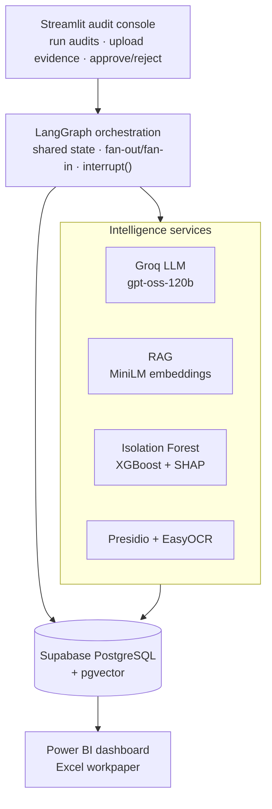
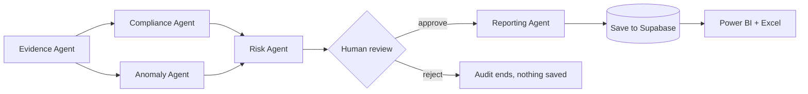

# Themis ⚖️

**A multi-agent AI framework for intelligent internal audit automation and risk analytics.**

Themis automates IT audit work: it collects evidence, maps it to security controls, detects suspicious access behaviour, scores risk, and produces an audit report and a control-evaluation workpaper — with a human approving every finding before it becomes final.

> **Design principle:** an LLM is never the sole source of a number, a label, or a compliance verdict.
> LLMs reason and explain. Deterministic code and ML compute. A human approves.

---

## Contents

- [Why Themis](#why-themis)
- [Features](#features)
- [Architecture](#architecture)
- [Audit workflow](#audit-workflow)
- [Agents](#agents)
- [How RAG works in Themis](#how-rag-works-in-themis)
- [Tech stack](#tech-stack)
- [Project structure](#project-structure)
- [Getting started](#getting-started)
- [Usage](#usage)
- [Power BI dashboard](#power-bi-dashboard)
- [Evaluation](#evaluation)
- [Limitations](#limitations)
- [Roadmap](#roadmap)
- [Author](#author)

---

## Why Themis

Internal auditors review large volumes of evidence — IAM exports, firewall rules, login logs, certificates, photos of access devices — and judge each against a control framework such as ISO/IEC 27001. This is slow, inconsistent between reviewers, and hard to scale.

Handing it to a chatbot creates a different problem: a model can confidently declare something "compliant" with no evidence behind it. Themis is built around a narrower, auditable question: **can every automated conclusion be traced to real evidence and signed off by a person?**

## Features

- **Multi-agent orchestration** with LangGraph — parallel execution (fan-out/fan-in) and a human approval gate
- **Evidence upload** for PNG, JPG, XLSX, PPTX and PDF, with multi-file analysis
- **PII masking** with Microsoft Presidio before any evidence reaches an LLM
- **RAG-based control matching** using sentence-transformer embeddings and pgvector similarity search
- **Confidence flagging** — weak evidence-to-control matches are reported as *Uncertain*, not forced into a verdict
- **Anomaly detection** on login behaviour with Isolation Forest, plus a downloadable flagged-records Excel export
- **Deterministic risk scoring** (0–100) with traceable contributing factors
- **Risk prediction** with XGBoost against a Logistic Regression baseline, explained with SHAP
- **Excel control-evaluation workpaper** — colour-coded Pass / Partial / Fail with observations and recommendations
- **Persistence** of every audit, finding, risk score, approval and agent run in Supabase (PostgreSQL)
- **Power BI dashboard** for executive, risk and anomaly analytics
- **Agent execution logging** (duration and status per agent) for evaluation

## Architecture



| Layer | Responsibility |
|---|---|
| Interface | Start audits, upload evidence, approve or reject findings, download reports |
| Orchestration | Run agents in the right order, share state, pause for human review |
| Intelligence | Retrieval, ML inference, LLM reasoning, OCR and PII masking |
| Data | System of record for controls, audits, findings, scores and logs |
| Insight | Management dashboard and audit deliverables |

## Audit workflow



1. The **Evidence Agent** gathers records for the selected scope and links them to controls.
2. **Compliance** and **Anomaly** agents run in parallel (fan-out).
3. The **Risk Agent** waits for both, then scores every finding (fan-in).
4. The graph **pauses** using LangGraph `interrupt()` and shows the top risks for review.
5. **Approve** → the Reporting Agent writes the executive summary and results are persisted.
   **Reject** → a conditional edge routes to `END`; no report, no LLM call, nothing saved.

## Agents

| File | Type | Responsibility |
|---|---|---|
| `workflows/audit_workflow.py` | Orchestrator | LangGraph state graph: ordering, parallelism, approval gate, timing logs |
| `agents/evidence_agent.py` | Rule-based | Links access and login records to controls; tags evidence as *violation* or *review*; reports gaps, never invents evidence |
| `agents/evidence_extraction.py` | Parser | Extracts text from images (EasyOCR), XLSX (openpyxl), PPTX (python-pptx, including tables) and PDF (pypdf) |
| `agents/compliance_agent.py` | LLM + RAG | Retrieves the closest control and produces a grounded status, observations and recommendation; returns *Insufficient Evidence* without an LLM call when nothing was collected |
| `agents/anomaly_agent.py` | Machine learning | Summarises Isolation Forest output per department and returns flagged records for export |
| `agents/risk_agent.py` | Deterministic | Computes a 0–100 risk score from compliance status, violation ratio and criticality |
| `agents/reporting_agent.py` | LLM (narration only) | Writes the executive summary from already-computed numbers, including anomaly results |
| `agents/results_tracker.py` | Report builder | Fills the control-evaluation workbook with colour-coded results |
| `security/pii_masking.py` | Security | Detects and masks names, emails, phone numbers and IP addresses |

> Root Cause and Analytics agents from the original design are planned as future work. Their responsibilities are currently covered by the Reporting Agent, the risk model and the Power BI dashboard.

## How RAG works in Themis

1. **Embed controls** — each control description is converted into a 384-dimensional vector with `all-MiniLM-L6-v2`.
2. **Store** — vectors are stored in the Supabase `controls` table using the `pgvector` extension.
3. **Embed evidence** — masked evidence text is embedded with the same model.
4. **Retrieve** — a SQL query ranks controls by cosine distance:
   ```sql
   SELECT control_id, control_name, embedding <=> %s::vector AS distance
   FROM controls ORDER BY distance LIMIT 3;
   ```
5. **Assess** — the LLM receives only the retrieved control and the evidence, and must return structured JSON.

A distance threshold (~0.78) separates strong matches from weak ones. Above it, the agent states that the control may not fit and returns *Uncertain* instead of a forced verdict.

## Tech stack

| Area | Tools |
|---|---|
| Language | Python |
| Orchestration | LangGraph |
| LLM | Groq — `openai/gpt-oss-120b` (provider-agnostic design) |
| Embeddings | sentence-transformers (`all-MiniLM-L6-v2`) |
| Database | Supabase (PostgreSQL) + pgvector, `psycopg` |
| ML | scikit-learn (Isolation Forest, Logistic Regression), XGBoost, SHAP |
| Data | pandas, NumPy |
| Evidence processing | EasyOCR, openpyxl, python-pptx, pypdf |
| PII masking | Microsoft Presidio, spaCy |
| UI | Streamlit |
| BI | Microsoft Power BI (via psqlODBC) |
| Notebooks | Jupyter |

## Project structure

```
themis/
├── app/
│   ├── agents/
│   │   ├── anomaly_agent.py
│   │   ├── compliance_agent.py
│   │   ├── evidence_agent.py
│   │   ├── evidence_extraction.py
│   │   ├── reporting_agent.py
│   │   ├── results_tracker.py
│   │   └── risk_agent.py
│   ├── database/
│   │   ├── persistence.py
│   │   └── test_connection.py
│   ├── ml/models/              # trained model files (.pkl)
│   ├── rag/
│   │   ├── populate_embeddings.py
│   │   ├── retrieve_controls.py
│   │   └── test_retrieval.py
│   ├── security/
│   │   └── pii_masking.py
│   ├── ui/
│   │   └── streamlit_app.py
│   └── workflows/
│       └── audit_workflow.py
├── data/
│   ├── synthetic/              # generator script + generated CSVs
│   ├── processed/              # cleaned data and outputs (git-ignored)
│   ├── raw/                    # evidence files (git-ignored)
│   └── templates/              # control-evaluation workbook template
├── notebooks/
│   ├── eda/01_data_cleaning_eda.ipynb
│   ├── anomaly_detection/02_anomaly_detection.ipynb
│   └── risk_prediction/03_risk_prediction.ipynb
├── powerbi/                    # Themis.pbix
├── docs/
├── requirements.txt
├── .env.example
└── README.md
```

## Getting started

### Prerequisites

- Python 3.11+
- Git
- A free [Supabase](https://supabase.com) project
- A free [Groq](https://console.groq.com) API key
- Power BI Desktop and the PostgreSQL ODBC driver (only for the dashboard)

### 1. Clone and install

```bash
git clone https://github.com/<your-username>/themis.git
cd themis
python -m venv venv
```

Activate the environment:

```bash
# Windows (PowerShell)
.\venv\Scripts\Activate.ps1
# macOS / Linux
source venv/bin/activate
```

Install dependencies:

```bash
pip install -r requirements.txt
python -m spacy download en_core_web_lg
```

### 2. Configure environment variables

Copy `.env.example` to `.env` and fill in your values:

```
DATABASE_URL=postgresql://postgres.<project-ref>:<password>@aws-0-<region>.pooler.supabase.com:5432/postgres
LLM_PROVIDER=groq
LLM_API_KEY=<your-groq-key>
```

> Use Supabase's **Session pooler** connection string. The direct connection requires IPv6, which many networks don't support. If your password contains `@`, encode it as `%40`.

### 3. Set up the database

In the Supabase SQL Editor, enable pgvector and create the tables:

```sql
create extension if not exists vector;

create table if not exists controls (
    id serial primary key, control_id text not null, framework text not null,
    control_name text not null, category text, criticality text,
    description text, embedding vector(384)
);
create table if not exists audits (
    id serial primary key, department text not null, framework text not null,
    status text not null, created_at timestamp default now()
);
create table if not exists findings (
    id serial primary key, audit_id integer references audits(id), control_id text not null,
    control_name text, compliance_status text, reasoning text, risk_note text
);
create table if not exists risk_scores (
    id serial primary key, finding_id integer references findings(id),
    risk_score integer, risk_level text, contributing_factors jsonb
);
create table if not exists anomalies (
    id serial primary key, audit_id integer references audits(id),
    total_logins_reviewed integer, anomalies_detected integer, anomaly_rate numeric
);
create table if not exists approvals (
    id serial primary key, audit_id integer references audits(id),
    decision text, decided_at timestamp default now()
);
create table if not exists reports (
    id serial primary key, audit_id integer references audits(id),
    executive_summary text, generated_at timestamp default now()
);
create table if not exists agent_runs (
    id serial primary key, audit_id integer references audits(id), agent_name text not null,
    duration_seconds numeric, status text, created_at timestamp default now()
);
```

Test the connection:

```bash
python app/database/test_connection.py
```

### 4. Generate data and train models

```bash
python data/synthetic/generate_synthetic_data.py
```

Then run the notebooks in order:

1. `notebooks/eda/01_data_cleaning_eda.ipynb` — validates data and writes cleaned files to `data/processed/`
2. `notebooks/anomaly_detection/02_anomaly_detection.ipynb` — trains Isolation Forest and writes `login_logs_with_anomalies.csv`
3. `notebooks/risk_prediction/03_risk_prediction.ipynb` — trains and compares the risk models, with SHAP

### 5. Load the control catalogue for RAG

```bash
python app/rag/populate_embeddings.py
python app/rag/test_retrieval.py      # optional sanity check
```

## Usage

### Web console

```bash
streamlit run app/ui/streamlit_app.py
```

- **Run Audit (synthetic data)** — choose a department, run the agents, review the top risks and non-compliant findings, then approve or reject. Approved audits show an executive summary and let you download the flagged login records as Excel.
- **Upload Evidence** — select one or more files, click **Analyze Evidence**, review the masked text and the control assessment, and download the control-evaluation workbook.

### Command line

```bash
python app/workflows/audit_workflow.py IT
```

The run pauses for approval; type `approve` or `reject` in the terminal.

## Power BI dashboard

Power BI connects to Supabase through ODBC (psqlODBC, SSL mode `require`) in Import mode. The native PostgreSQL connector may fail certificate validation against Supabase, so ODBC is the recommended route.

| Page | Shows |
|---|---|
| Executive Overview | Compliance %, non-compliant and critical counts, compliance-status breakdown, risk by department |
| Risk Analytics | Risk distribution, top controls by risk score, sortable findings |
| Anomaly & Security | Anomalies and anomaly rate by department, overall anomaly rate |

The overall anomaly rate uses a DAX measure rather than summing per-department rates:

```
Overall Anomaly Rate = DIVIDE(SUM(anomalies[anomalies_detected]), SUM(anomalies[total_logins_reviewed]))
```

## Evaluation

| Area | Result |
|---|---|
| Anomaly detection | Flagged logins were 57.5% after-hours (vs ~7–10% overall) and 38.4% from unusual countries (vs ~2% overall) |
| Risk prediction | Logistic Regression ROC-AUC 0.563 vs XGBoost 0.474 — XGBoost overfit the 96-row history; reported, not hidden |
| RAG retrieval | MFA/privileged-access query returned A.8.5 and A.8.2 without keyword overlap |
| PII masking | 390 sensitive items masked in a single evidence spreadsheet |
| Agent runtime (4 audits) | Compliance 49.0s · Reporting 2.3s · Evidence 0.10s · Anomaly 0.08s · Risk <0.01s |
| Reliability | All logged agent runs completed successfully |

The Compliance Agent accounts for roughly 95% of runtime because it is the only agent making repeated LLM calls; the deterministic agents are nearly free.

## Limitations

- Audit data is **synthetic** by design, with known injected anomalies so models can be graded.
- The historical dataset is small (96 rows), which limits the predictive model.
- OCR quality varies; small, low-resolution screenshots extract poorly.
- LLM-based verdicts can vary slightly between runs on borderline evidence.
- The control catalogue covers a limited scope, so out-of-scope evidence is flagged as *Uncertain*.
- Access control is not yet role-based.

## Roadmap

- [ ] Root Cause agent for clustering recurring findings
- [ ] Cross-framework mapping (ISO 27001, NIST CSF, CIS Controls, SOC 2)
- [ ] Role-based access (Auditor, Reviewer, Admin, Viewer)
- [ ] Custom web frontend on FastAPI
- [ ] SHAP explanations surfaced in the UI
- [ ] Evidence integrity hashing (SHA-256) for chain of custody
- [ ] Docker packaging and deployment

## Security notes

- Secrets live in `.env`, which is git-ignored. Never commit real credentials.
- Evidence files in `data/raw/` and generated outputs in `data/processed/` are git-ignored.
- Personal data is masked before any text is sent to the LLM.
- No finding is persisted without explicit human approval.

## Author

**Harsh Kumar** — MBA, Data Science & Data Analytics

Built as a final-year project combining agentic AI, machine learning, data engineering, business intelligence and governance, risk and compliance.
